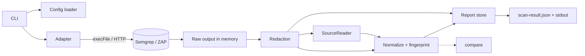

# 02 — Architecture

Status: approved. Owns: components, module boundaries, scan pipeline, report storage, redaction, serialization.

## Components

| Component | Responsibility | Path |
|---|---|---|
| CLI command layer | Parse args, call use cases, print one envelope | `src/cli` |
| Configuration loader | Validate `tools.yaml` (strict Zod) | `src/config` |
| Tool catalog | Fixed map `semgrep`, `zap` to built-in adapters | `src/adapters/index` |
| Semgrep / ZAP adapters | `probe`, `scan`, `parse`, `normalize` ([05](05-tool-adapters.md)) | `src/adapters/*` |
| Process / API boundary | Injected `Runner` (execFile) and `HttpClient`, used by adapter `probe`/`scan` | `src/adapters/io` |
| Orchestration ports | Injected `SourceReader` (snippet reads) and target-identity reader (git via `Runner`, directory walk) | `src/cli/ports` |
| Report store | Only module that writes artifacts | `src/cli/store` |
| Redaction | Pure JSON-tree redaction | `src/core/redaction` |
| Normalization layer | Adapter output to shared findings | `src/core/findings` |
| Fingerprint generator | Canonicalize and hash | `src/core/fingerprints` |
| Canonical serializer | Stable bytes for `normalized.json` and `scan-result.json` | `src/core/serialization` |
| Comparison engine | Deterministic base/head diff | `src/core/comparison` |
| Machine output / diagnostics | JSON envelope to stdout, logs to stderr | `src/cli` |
| Schemas | Zod source and emitted JSON Schema | `src/schemas`, `schemas/` |

`core/` is pure: no IO, no clock, no environment access. Adapter IO is limited to `probe` and `scan` through injected `Runner`/`HttpClient`; `parse`, `sourceRefs` and `normalize` are pure. All other IO belongs to the orchestration layer behind injected ports:

- `SourceReader` reads a line range of a file inside the target: containment-checked, symlinks not followed, 1 MiB cap, UTF-8 validated. It returns text or a typed failure reason (which becomes a degraded fingerprint, [04](04-finding-schema.md)).
- The target-identity reader computes the target digest.

Adapters and `core/` never touch the filesystem. The CLI wires everything. No plugin framework.

## Target models

- Semgrep analyzes a directory (a checked-out worktree).
- ZAP analyzes an already-running HTTP origin. Scanbridge never starts the target app or ZAP.

## Flow



## Scan pipeline (order is a contract)

1. Validate flags and config; resolve root; compute `configuration_digest` and policy version.
2. Probe the tool (`doctor` logic, read-only).
3. Compute target identity digest (Semgrep) through the target-identity port — first reading.
4. Execute or query; accumulate bounded raw output in memory only.
5. Hash the original producer output: `raw_sha256_before_redaction`. Semgrep: the stdout bytes. Live ZAP: the `{"alerts":[...]}` document assembled in memory from the paginated responses, keeping page order and duplicates, serialized as RFC 8785 canonical JSON; deduplication and sorting happen later in normalization. Offline ZAP: the file bytes.
6. Parse; redact the parsed data; serialize the redacted raw document as a raw artifact (see Deterministic serialization); `raw_sha256_after_redaction` is computed from the exact bytes persisted.
7. Semgrep only: the orchestrator takes the adapter's pure `sourceRefs(doc)`, reads each range through `SourceReader`, redacts and canonicalizes the text, and passes the results to `normalize`.
8. Compute fingerprints from redacted, canonical material.
9. Normalize, group, sort, apply limits; classify completeness and authority.
10. Compute target digest — second reading. A difference makes the scan `partial` (`target_changed_during_scan`).
11. Persist redacted raw, then `normalized.json`, then `scan-result.json`; print the same envelope.

Unredacted producer output exists only in memory between steps 4 and 6. Unredacted source snippets may briefly exist in memory during step 7. Source snippets are redacted before normalization, fingerprinting, persistence, stdout, stderr, diagnostics or logs, and neither kind of unredacted data ever reaches disk, stdout, stderr, diagnostics or logs.

## Report storage

```text
<output>/<scan_id>/raw/<producer-shaped-file>.json   redacted, only if raw evidence exists
<output>/<scan_id>/normalized.json                   only if normalization succeeded
<output>/<scan_id>/scan-result.json                  always when the directory could be created
```

- `scan_id` = UTC timestamp with milliseconds + 8 hex of a digest of config and target, e.g. `20261013T142501.123Z-3fa9c0d1`.
- The scan directory is created exclusively; an existing one is never overwritten. A missing `<output>` base is created.
- No empty reports. Failed scans write no `normalized.json`; a failure that leaves no safe evidence writes no `raw/`.
- Raw files are "producer-shaped but redacted", never byte-exact. ZAP raw is the redacted `{"alerts":[...]}` document assembled from all pages.
- If failure occurs before the directory exists, the envelope is still printed with artifact paths `null`.

## Redaction

- Applies to raw and normalized output before persistence, over every string in the parsed JSON tree. Producer text is redacted before truncation.
- Built-in rules (Scanbridge-owned, fixed ids, versioned): header names `Authorization`, `Cookie`, `Set-Cookie`, `X-API-Key`; JSON keys containing `token`, `password`, `secret` (case-insensitive); value patterns for private-key blocks, assignment-style values (`name = value`, `name: value`, `name=value`, including URL query) whose name contains `token|password|secret|api_key|apikey`, `Bearer` credentials, and a small documented set of provider-token formats.
- Configurable additions: exact header names, exact JSON key names, exact values of named environment variables (value ≥ 8 chars, name matches `^[A-Za-z_][A-Za-z0-9_]{0,63}$`). No regular expressions.
- Semgrep `extra.metavars` is removed entirely from raw and never used. Only a removal count is recorded.
- Replacement token `[REDACTED:<rule-id>]`. Findings that lost or changed any value carry `redactions_applied: true`.
- `redaction_policy_version` = `<builtin-version>+<12 hex of digest of effective policy>`; environment-variable names are included, values never.
- Fail closed: if raw cannot be parsed or safely redacted, persist no raw and no normalized artifact; emit `redaction_failed` in a sanitized `scan-result.json`.
- Pattern redaction is best-effort ([README](README.md) limitation).

## Deterministic serialization

- `normalized.json` is byte-reproducible for identical raw evidence, config, rules, producer version and target content.
- Zod validates and defines field shape; it does not guarantee key order. Stable bytes come from an explicit canonical serializer in `src/core/serialization`, written with `JSON.stringify` over objects rebuilt in declared order, so no extra runtime dependency.
- The serializer owns: a declared field-order list per object type at every level (a test asserts each list covers exactly the Zod keys); findings sorted by fingerprint; occurrences by canonical location; every other array whose order is not semantic (`references`, reasons, redaction counts by rule id) sorted by code-point order of its canonical string and deduplicated; 2-space indentation; UTF-8; LF; exactly one trailing newline. The schema contains integers only, so number output is deterministic.
- `scan-result.json` uses the same serializer (it also holds volatile run data).
- Redacted raw artifacts do not go through the canonical serializer. They preserve the parsed producer object-key and array order, and no normalization sorting rule reorders them. They use two-space indentation, UTF-8, LF and exactly one trailing newline. `raw_sha256_after_redaction` is computed from the exact bytes persisted.
- Fingerprint material uses the separate RFC 8785 canonical JSON algorithm ([04](04-finding-schema.md)); the two are not interchangeable.
- Truncation limits and structured text fields: [04](04-finding-schema.md).

## Source layout

```text
src/{cli,config,core/{findings,fingerprints,comparison,redaction,serialization},adapters/{semgrep,zap},schemas}
tests/{fixtures,unit,contract,integration}
schemas/        committed JSON Schema, generated from Zod
```

`core/redaction` is added to the layout suggested in the initial prompt.
