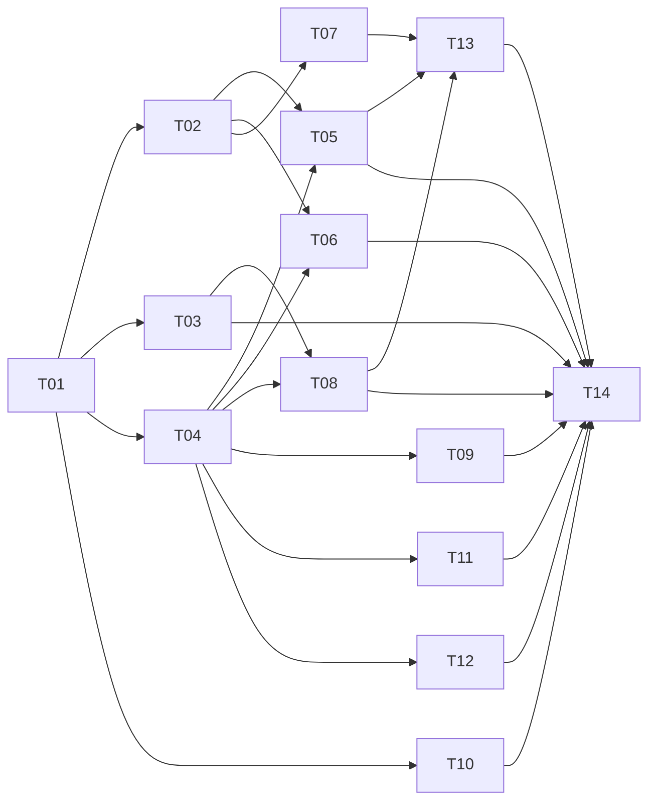

# Scanbridge implementation tickets

Derived from the approved specs in `specs/` (read `specs/README.md` first). Specs are not modified; design decisions are not reopened; `[verify]` items stay marked and are not resolved by guessing.

## Tickets

Every ticket starts with the same metadata block (`Model`, `Status`, `Depends on`, `Parallel group`, `Branch`) and ends with a required `## Handoff` section. `Status` is `ready` only for T01; set a ticket to `ready` when everything in its `Depends on` is merged to `main`. `Model` is `Sonnet` where a ticket needs cross-cutting judgment (T01 contracts, T06 findings core, T12 live scan state machine, T14 orchestration), otherwise `Haiku`.

| # | Ticket | Model | Group | Depends on | Owns (top-level) |
|---|---|---|---|---|---|
| T01 | [Scaffold and shared contracts](T01-scaffold-and-contracts.md) | Sonnet | G0 | — | `package.json`, `tsconfig.json`, `src/contracts/` |
| T02 | [Document schemas](T02-document-schemas.md) | Haiku | G1 | T01 | `src/schemas/`, `schemas/`, `scripts/` |
| T03 | [Redaction engine](T03-redaction-engine.md) | Haiku | G1 | T01 | `src/core/redaction/` |
| T04 | [Fingerprints and identity](T04-fingerprints-and-identity.md) | Haiku | G1 | T01 | `src/core/fingerprints/` |
| T10 | [Semgrep adapter](T10-semgrep-adapter.md) | Haiku | G1 | T01 | `src/adapters/semgrep/` |
| T05 | [Persistence and serializer](T05-persistence-and-serializer.md) | Haiku | G2 | T01, T02, T04 | `src/core/serialization/`, `src/cli/store/`, `src/cli/output-dir.ts` |
| T06 | [Findings core](T06-findings-core.md) | Sonnet | G2 | T01, T02, T04 | `src/core/findings/` |
| T07 | [Comparison engine](T07-comparison-engine.md) | Haiku | G2 | T01, T02 | `src/core/comparison/` |
| T08 | [Config loader](T08-config-loader.md) | Haiku | G2 | T01, T03, T04 | `src/config/` |
| T09 | [IO ports](T09-io-ports.md) | Haiku | G2 | T01, T04 | `src/adapters/io/`, `src/cli/ports/` |
| T11 | [ZAP parse and normalize](T11-zap-adapter-parse-normalize.md) | Haiku | G2 | T01, T04 | `src/adapters/zap/{parse,normalize,severity}.ts` |
| T12 | [ZAP probe and live scan](T12-zap-adapter-live.md) | Sonnet | G2 | T01, T04 | `src/adapters/zap/{probe,scan}.ts` |
| T13 | [CLI shell, doctor, compare](T13-cli-shell-doctor-compare.md) | Haiku | G3 | T01, T02, T05, T07, T08 | `src/cli/{main,args,envelope,exit}.ts`, `commands/{doctor,compare}.ts` (and the `scan` stub) |
| T14 | [Scan orchestration and e2e](T14-scan-orchestration.md) | Sonnet | G4 | all | `src/cli/scan/`, `commands/scan.ts`, `src/adapters/{index.ts,zap/index.ts}` |

Fourteen tickets, slightly above the 8–12 target. ZAP is split because the live flow is isolated risk; T09, T10 and T14 name optional split points if a session runs long.



## Groups and parallelism

- **G0:** T01 alone. Merge before anything starts.
- **G1 (4 parallel):** T02, T03, T04, T10.
- **G2 (7 parallel, each starts when its dependencies are merged):** T05, T06, T07, T08, T09, T11, T12. T11 and T12 do not depend on each other and share no files; both need only T04. No two G2 tickets own the same file.
- **G3:** T13. **G4:** T14, which also assembles the ZAP adapter (`src/adapters/zap/index.ts`) and the tool catalog after T11 and T12 are merged.

## Worktree workflow

```bash
git worktree add ../scanbridge-wt/T02 -b ticket/T02-schemas main   # from up-to-date main, after dependencies merged
cd ../scanbridge-wt/T02 && npm ci
```

- One session, one worktree, one branch per ticket (branch names are in each ticket header).
- Edit only the paths in the ticket's **Owns** list. Never edit `specs/`, `tickets/`, another ticket's files, `package.json` or `package-lock.json` (T01 only). If a contract in `src/contracts/` is wrong, say so in the summary and stop; the integrator amends T01.
- Before opening the merge: `git rebase main`, then `npm run build && npm test` (and `npm run check:schemas` once T02 exists).
- Merge order: group order (dependencies first), `--no-ff`, one at a time; run `npm ci && npm run build && npm test` on `main` after each group. Ownership is disjoint, so merges do not conflict.
- Remove the worktree after merging: `git worktree remove ../scanbridge-wt/T02`.

## Conventions for every ticket

- TypeScript ESM, strict; `.js` suffix on relative imports; `node:test` and `node:assert/strict`; tests named `*.test.ts` under the ticket's own `tests/<layer>/<area>/` directory.
- No new dependency. `core/` and `adapters/` (except `adapters/io`) import no `fs`, read no `process.env` or clock (enforced by the T01 boundary test).
- Adapters take separate probe and scan contexts (T01); there are no dummy targets, scan IDs or keys. The ZAP API key exists only as a `SensitiveString` in memory, never logged, persisted, digested or put in diagnostics; `.reveal(` is allowed only in `src/adapters/io/`. Never log it, put it in config, digests, diagnostics, errors or artifacts.
- Fixtures are sanitized or synthetic, one directory per case with a `PROVENANCE.md` containing a `Producer version:` line (the version, or `unknown — verify against real <tool>`), the source command and sanitization notes. No real credentials.
- Tests live in the same ticket as the behavior. Default tests need no Semgrep, ZAP, git remote or network.
- Treat all producer text as untrusted: never interpolate it into diagnostic `message`.
- Keep code and comments minimal and use the specs' vocabulary.

## Verification items (V1–V9) coverage

Each owning ticket keeps the item marked `[verify]` in code comments and fixtures; none resolves it by guessing. Real resolution needs live tools and happens after this backlog.

| ID | Item | Tickets | Handling |
|---|---|---|---|
| V1 | Semgrep exit 7 | T10 | Non-zero exit stays `failed`; marked in `scan` and tests |
| V2 | List-encoded Semgrep error types | T10 | Classify per documented table; fixtures marked |
| V3 | ZAP field names, casing, risk strings, endpoints | T11 (`FIELDS`, `zap-1` strings), T12 (endpoint table) | One table each, comments and `PROVENANCE.md` marked |
| V4 | `--disable-nosem` on the pinned version | T10 | Argv pinned; behavior not asserted |
| V5 | Versions to pin for fixtures | T14 (integration test over every `PROVENANCE.md`), T10, T11 (write the lines) | Unknown versions are written as `unknown — verify`; no pinning guessed |
| V6 | Semgrep timeout-threshold skips in `paths.*` | T10 | Rely on `errors[]` only |
| V7 | Resolved-rule digest for registry and `auto` | T08 (`rulesDigest` is `null`), T10 (reasons only) | `null` until verified |
| V8 | Sufficiency of redaction patterns | T03 | Fixed 12-rule table marked; no sufficiency claim |
| V9 | Limit values | T01 (constants), T04, T06, T08, T09, T10, T12 (use them), T14 (final validation) | Constants only in `src/contracts/limits.ts`; boundary tests; T14 checks no duplicated literals |

## Locked implementation decisions

The specs are silent or ambiguous on these. They are decided; implementers apply them as written and reopen none. Reviewers who disagree amend the ticket, not the code.

1. **Scan directory timing:** created right after pre-flight validation and before probing (T14), so every later failure can write `scan-result.json`.
2. **Header redaction shapes:** both object keys and `{name, value}` header pairs are redacted (T03).
3. **Evidence comparison:** only `{text}` values count; `message_id` and locations do not (T07).
4. **ZAP alert URL with control characters or unparsable:** excluded and counted as `out_of_scope_target` (T11).
5. **`findings_count`:** number of normalized (grouped) findings (T14).
6. **Compare `base`/`head`/`metadata` shapes:** exactly the minimal fields listed in T02.
7. **Node and module system:** Node `>=22`, ESM, TypeScript `NodeNext` (T01).
8. **Adapter handoff types** (`Candidate`, `NormalizeContext`, `ScanOutput`, probe and scan contexts, ports, `SensitiveString`) are internal design fixed in T01.
9. **Plain-string producer fields** (`severity_original`, `category`, `references[]`, `message_id`) are sanitized but not truncated (T06); only the raw and normalized size caps bound them.
10. **Probe and scan contexts are separate** (T01): Semgrep probe needs no target; ZAP probe needs only API URL and `SensitiveString` key; offline ZAP calls neither `probe` nor `scan`.
11. **ZAP input resolution is purpose-specific** (T08): doctor (API URL and key), live scan (API URL, key, target URL), offline (target URL only). `doctor` never needs a target URL.
12. **Provider-token redaction patterns** are the fixed, versioned table in T03 (`[verify]` V8); implementers choose none.

## Definition of done (whole backlog)

`specs/06-testing-and-acceptance.md` "Acceptance — MVP implementation" holds on merged `main`: all coverage passes with the default test command and no external tools, every documented command works, runtime dependencies are `yaml` and `zod` only, and fixtures remain marked `[verify]` until checked against real Semgrep and ZAP (V1–V9).
